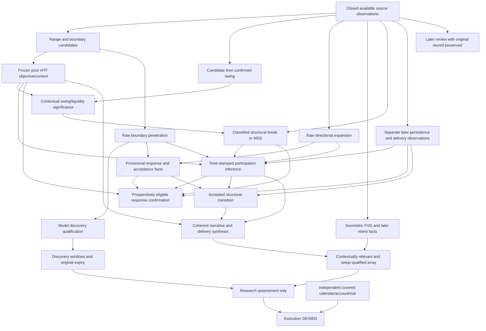

# Evidence dependency graph v0.3 — first model

**DRAFT — NOT APPROVED FOR EXECUTION.**

## Scope and definitions

Graph edges below mean evidentiary prerequisite, not a mandatory candle/event order
implied by the model name. Several observations can share one bar; that bar must
not be counted as multiple independent confirmations. **Shared observation:** the
same source event contributes to distinct assessments. **Independent confirmation:**
a separate available observation adds information not already assumed by the claim.
Disjoint bars alone do not guarantee informational independence; repeated hashes or
labels do not create it. D31 explicitly forbids using the original MSS candle alone
as sufficient subsequent delivery confirmation. Sources: C-PART/C-AST/C-PD; D17–D36;
prior dependency review; P05/P09/P10/P11/P13/P14.

## Proposed nonexecuting dependency graph

H0 uses historical/controlling auction context, not the current candidate's successful
MSS/FVG or target outcome. RC/SC selection predicates remain null. LATER describes raw
facts, not an already completed Price Delivery stage requiring AST. A later updated
PART record can use later facts but cannot backdate its support into an earlier PART.
ROUTE→AST is deliberately not assumed when ROUTE requires the same AST; the response
state sufficient for AST is an unresolved owner choice. Similarly final NARR cannot
be a required input to its own upstream participation claim. The graph is a proposed
acyclic layering, not proof that all sufficient predicates or source authority exist.

## Eight explicit circularity risks and minimal specification repairs

| Risk | Invalid cycle / double count | Minimal nonexecuting repair | Decision/predicate links |
|---|---|---|---|
| CY01 liquidity significance vs HTF bias | Significance proves objective, objective chosen because that same candidate was significant | Freeze independent earlier context/range candidate set, then rank later candidate significance; retain alternative unresolved candidates | D19/D22/D24; P01/P12/P22 |
| CY02 rejection vs displacement | Rejection direction assumed to label displacement; the label then proves rejection | Record raw directional expansion/return separately under explicit research profile; response inference references those facts, not its own label | D20/D27/D33; P03/P04/P07 |
| CY03 participation vs displacement | Assume institutions to call a candle decisive; call it proof of institutions | Raw geometry first, contextual interpretation second, additional independent observations with lineage and alternatives; no identity attribution | D27/D32; P03/P05 |
| CY04 MSS vs structural significance | Broken swing declared significant because this MSS broke it; MSS needs significance | Timestamp candidate→confirmed state and prior contextual significance evidence independently of the tested break | D23/D28/D29; P09/P12 |
| CY05 persistence vs delivery | Persistence accepted because delivery confirmed, delivery confirmed because accepted persistence | Separate raw completed-bar/retest persistence from later path/objective/integrity observations; conjunction cannot be satisfied by relabeling the original MSS bar | D30/D31; P09/P10/P11 |
| CY06 FVG relevance vs participation | FVG proves participation, participation assumed to call FVG relevant | Detect geometry without institutional claims; earlier independent participation/context supports later relevance, not vice versa on same evidence | D26/D32; P05/P14 |
| CY07 narrative vs accepted structure | Narrative proves AST and AST proves that same narrative; rejection route also depends on AST that requires its confirmed rejection | Prior context/preliminary response + raw persistence/delivery precede AST; later narrative synthesizes. Route semantics must avoid self-reference or stay null | D31/D33/D35; P07/P11/P13 |
| CY08 confirmation vs profitable future | Winning outcome retroactively proves initial qualified setup | Freeze original cutoff/hypothesis/evidence; outcome only in later process review, no rewriting bias/route/expiry | D17/D33/D36; P17/P21 |

Repairs are source/evidence separation proposals, not new sufficient trading rules.
Shared input sets remain disclosed even when no directed cycle exists. Acyclic
reasoning can still be unsupported if every input is a supplied assertion.

## Evidence record obligations

For each claim retain source/instrument/tick unit, event interval, close/availability,
claim-known time/cutoff, exact derivation/version, supporting and contradictory refs,
shared ancestor sets and unresolved alternatives. Separate original versus updated
context. No counter of record labels substitutes for independent evidence: E's
observation_ladder.Differentiate.independent_observations equals observations.length,
including unresolved observations, and must not be used as an independence threshold.

Existing Trading consumer invokes the same pinned Sentinel evaluator. Agreement
between those two entry points is not independent confirmation. Independence comes
from Sentinel recomputing raw evidence without importing Trading's ICT detector;
shared evaluator calls/pins only verify compatibility, not a second analytical vote.

A one-off documentation check verifies the proposed graph has no directed cycle.
It does not validate null predicates, statistical independence, trading edge or the
full reasoning of a future implementation. Legacy cycles above remain blocked unless
the proposed separation and missing operational semantics are reviewed and tested.
