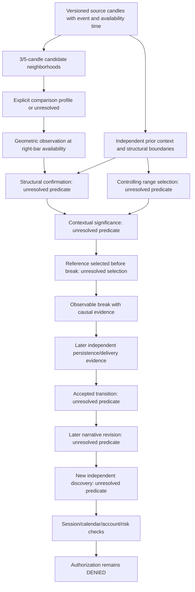

# Phase 53 — Dependency, contradiction and circularity review

**DRAFT — NOT APPROVED FOR EXECUTION.**

Execution authorization: **DENIED**. This document distinguishes causal engineering invariants from still-null trading sufficiency. Source: Decision53 directive §§3–12; `/home/rain/Downloads/IMAF_Decision_Records_37-52.md` individual records (all selectedD); prior [evidence graph](../EVIDENCE_DEPENDENCY_GRAPH_V0.3.md), [conflict report](../DOCTRINE_CONFLICT_REPORT_V0.3.md), [predicate register](PREDICATE_INVENTORY.md), manuscript [source catalog](../IMAF_CANONICAL_SPEC_V0.3_DRAFT.md#exact-manuscript-source-catalog).

## Causal layering

The canonical analytical sequence is Time → Liquidity → Institutional Participation → Liquidity Acceptance/Rejection → Accepted Structural Transition → Price Delivery → Market Narrative → Professional Execution → Professional Risk → Professional Review. This sequence is an analytical discipline, not permission to require a final downstream classification before every earlier raw observation. Observable delivery can inform earlier evidence assessments; final Price Delivery and narrative classifications remain separate conclusions.

Arrows into unresolved boxes describe prerequisites, **not approved sufficient conditions**. Independent prior accepted context may inform initial range selection (D42), but the **new** transition evaluated against that range may not create its own prior range. If no independent prior anchors exist, selection remains unresolved; do not bootstrap context from the same new MSS. Missing authentic source/calendar/account data cannot be replaced with synthetic claims.

## Approved engineering vs unresolved rules

| Category | Scope |
|---|---|
| Narrow engineering authorization | Stable versioned identity; immutable lineage; event/availability/classification separation; complete3/5 neighborhoods; causal cutoff; explicit research comparison profile; duplicate/shared-event disclosure; deterministic offline replay; terminal no-revival boundary |
| Unresolved trading sufficiency | Default comparisons/ties, structural confirmation/significance, range construction/ranking/replacement, MSS reference eligibility, contextual routes, participation independence minimums, liquidity response, accepted transition, narrative revision, fresh discovery/expiry |
| Prohibited assumption | OHLC proves institutional actor or intrabar order; pivot/MSS/FVG proves accepted transition; technical labels prove independence; success selects historical range/reference; null silently means approved |
| Missing authoritative data | Actual market-source/version/receipt provenance, covered exchange calendar, account trade-count/exposure/error history, approved model-specific predicates. Synthetic fixtures validate mechanisms only |
| Owner approval needed next | [Minimal decision queue](OWNER_DECISION_QUEUE.md); no current source-recovery blocker for D37–52 |

## Specific circularities and independent requirements

| Risk | Invalid loop | Independent requirement / causal guard |
|---|---|---|
| Range ↔ accepted transition | New MSS proves controlling range, same range proves its MSS is externally significant | D42: independent prior boundaries/objective/accepted context; selected range timestamp before evaluated break. Missing anchors → unresolved |
| Reference ↔ MSS | Breaking a pivot proves it was significant and therefore eligible reference | D37/38/40: confirmation, significance and selection all known before MSS. Later break never backdates reference eligibility |
| Participation ↔ narrative | Chosen narrative proves institutions participated; inferred participation proves narrative | D32/47/51: underlying observable evidence, alternatives and dependency graph; no actual institutional attribution from OHLCV |
| Geometry ↔ confirmation | Displacement/MSS/FVG labels from one event counted as three confirmations | D39/50/51: shared transitive event ancestry; count observations separately but never call them independent. Disjoint IDs alone do not establish sufficiency |
| Confirmation-route hindsight | Winning outcome chooses displacement/liquidity/departure or delivery route | D41/52: route eligibility set from pre-outcome context and version; route thresholds remain null; retain failed/contradictory routes |
| Target ↔ initial bias | Later target reached proves earlier direction and selects favorable range | P01/P22/D19/24: retain original objective and selection evidence before outcome; target-ranking sufficiency still null |
| Internal ↔ external revision | Later HTF break rewrites original internal transition as already external | D45/46: original event/classification immutable; promotion has later evidence and timestamp; external significance ≠ accepted HTF transition ≠ narrative revision |
| Narrative ↔ setup revival | New narrative relabels prior expired/invalidated setup as freshly valid | D47–50: discovery-time snapshot, terminal identity and original finite bound immutable; new independent qualification required; newID alone insufficient |
| Calendar ↔ allowance | Local date or setup rename resets one-trade allowance | P18/P19/D53§11: authentic exchange-day ID and account history; missing authority → no eligibility |
| Aggregation ↔ early knowledge | Completed HTF bar imported into an earlier LTF evaluation | Source interval completion and receipt both ≤cutoff; preserve constituent event ancestry; incomplete aggregate cannot become prior evidence |

Classification timestamp must be ≥maximum dependency availability; geometric recognition must additionally await the required right-hand completion. The pivot's own candle timestamp is not its recognition time. Out-of-order receipt changes earliest knowability, not historical market-event identity. Original classifications cannot be overwritten by revised data/specification; revisions require explicit versioned provenance and separate replay interpretation.

## Contradiction/scope register

| Conflict | Retained distinction and owner review options |
|---|---|
| Liquidity acceptance vs rejection | D33/34 response routes remain null; preserve both competing observations. Do not select the successful route after outcome. Owner must specify route eligibility, sufficiency and same-time conflict precedence |
| Structural break vs accepted transition | D28–31/37–41: geometry and observed break are facts; accepted transition needs independent approved persistence/delivery/response. Options are unresolved until those predicates exist; no automatic promotion |
| Participation vs delivery | D32/51/52: source observations can serve multiple roles with shared lineage, but same event is not independent subsequent delivery. Owner defines event independence and sufficient later delivery; engineering overlap detection only withholds a false independence claim |
| HTF vs LTF narrative | D42–47: preselected controlling context governs interpretation; internal move is not automatic HTF reversal. If competing ranges remain plausible, D43 requires standaside for range-dependent qualification; no arbitrary vote |
| Discovery vs confirmation | D17/49: new qualifying event within selected discovery window can precede later confirmation; no FVG/MSS retroactive discovery. Exact model qualifying event remains null |
| Expiry vs subsequent liquidity | D17/36/49: later event cannot extend original finite bound or revive old setup. New identity requires independently qualified new event; exact expiry authority and freshness remain null |
| Calendar date vs exchange day | P18/P19: one trade/exchange day retained; no hardcoded midnight reset. Calendar authority/coverage not demonstrated by synthetic tests |
| Strategy vs account restriction | P19/P20: synthetic strategy validity does not prove authentic account allowance, exposure or operator/broker permission. All restrictions remain independent and conjunctive |
| Earlier NY/research session vs latest CT selection | Preserve historical Phase3 spec/replays; current D53 retains CT four-window selection. Prior v0.3 found5/13 helper-window mismatches; this increment does not silently patch helper or canonize legacy behavior |
| State/schema proposal vs runtime contract | D47 TRANSITION_UNDER_REVIEW and D50 proposed field names are proposals; offline research representation must not mutate established runtime contract or advertise an approved strategy registry |

No substantive conflict is resolved by inventing a threshold. Most conflicts are boundary errors rather than doctrinal contradictions; the safe resolution already selected by the owner is to withhold unsupported conclusions. Exact sufficiency remains for owner review.

## Verification obligations

A/B verify right-bar knowability; C/E verify shared-event lineage; D/F block reference hindsight and null promotion; G verifies identical input/spec/cutoff determinism; H blocks terminal revival. Adversaries must cover missing/out-of-order/revised/contradictory inputs and aggregation leakage. This report makes no test-result claim; actual commands, counts, failures and limitations belong to the independent acceptance report.
